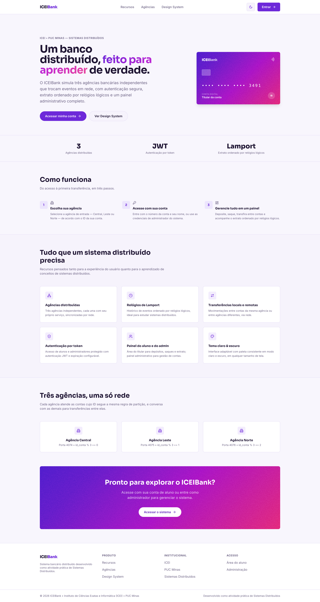
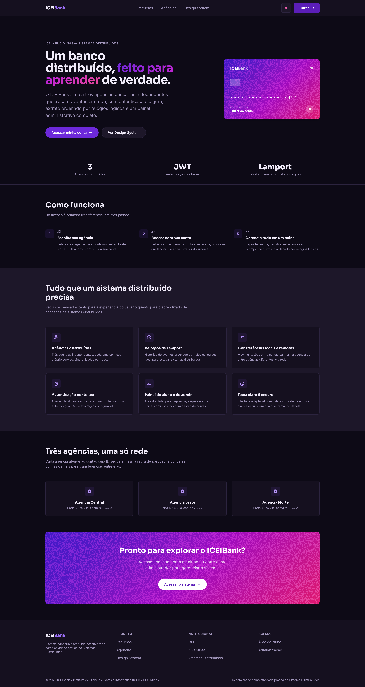
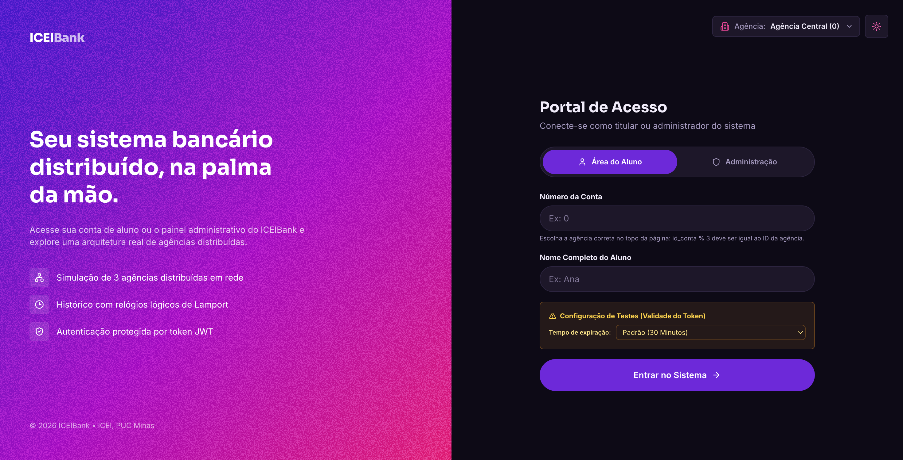
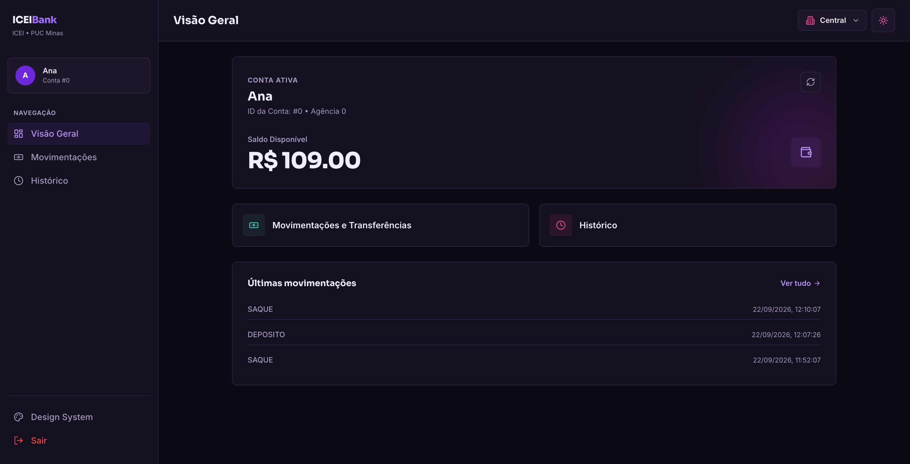
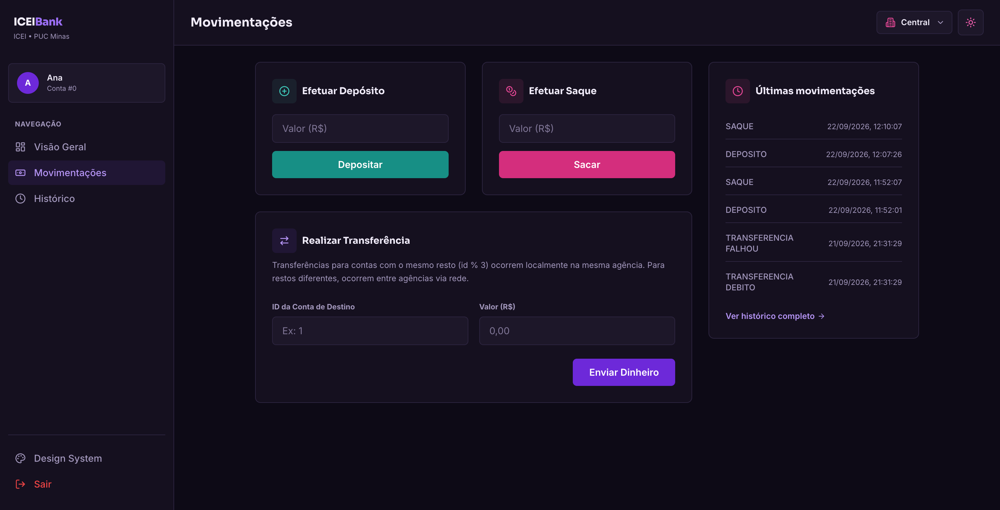
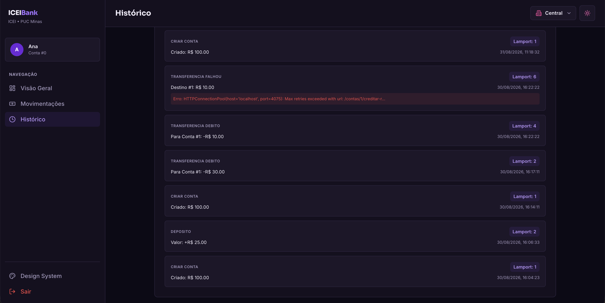
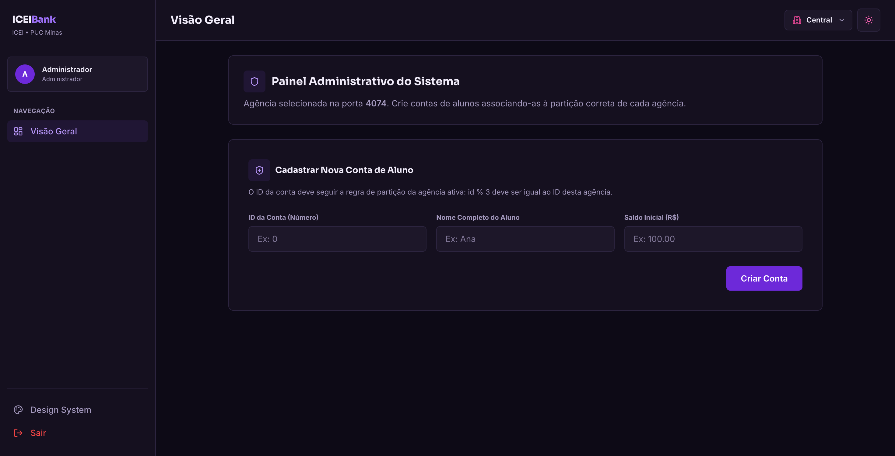
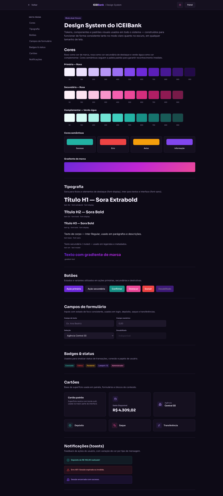

# ICEI Bank
O ICEIBank é o primeiro de quatro sprints de um sistema bancário distribuído, criado para aplicar na prática conceitos de Sistemas Distribuídos e Desenvolvimento Web. O objetivo desta etapa é construir o backend de agências bancárias independentes e um frontend funcional, garantindo a consistência e o rastreamento das transações.

**Principais Características e Requisitos**

* **Arquitetura e Particionamento:** O sistema opera com três agências independentes (partições). Cada conta pertence exclusivamente a uma agência, determinada pelo cálculo `id_conta % 3`.
* **Relógio Lógico de Lamport:** Toda operação (criação de conta, depósito, saque, transferência) recebe um carimbo de tempo (*timestamp*) baseado no algoritmo de Lamport, permitindo ordenar de forma lógica os eventos descentralizados do sistema.
* **Operações REST e Autenticação:** A API deve suportar um CRUD de contas e transferências locais e remotas (via chamadas diretas entre agências). Todas as rotas de operação exigem autenticação via token JWT.
* **Frontend:** Uma interface web funcional que consuma a API, gerencie o login, realize transferências e exiba erros de forma clara para o usuário.
* **Observabilidade e Falhas:** Existe uma limitação intencional neste sprint: se a agência de destino falhar no meio de uma transferência, o débito da origem não é revertido. Todos os eventos geram logs locais que podem ser mesclados em uma linha do tempo unificada.
* **Funcionalidade Adicional:** É obrigatório criar ao menos um recurso extra de autoria própria (ex: limite de saque, histórico de transações).
--- 
## 📁 Estrutura de Pastas do Projeto

Abaixo está o esqueleto de diretórios e arquivos que estruturam o projeto:

```text
ICEIBank/
├── agencia/                     # Backend Python (FastAPI)
│   ├── data/                    # Logs de eventos gerados em runtime (ignorado pelo git)
│   ├── src/
│   │   ├── controllers/
│   │   │   ├── contas_controller.py
│   │   │   └── transferencias_controller.py
│   │   ├── services/
│   │   │   ├── auth.py          # Criptografia, geração e validação de tokens JWT
│   │   │   ├── event_log.py     # Sistema de log de eventos locais da agência
│   │   │   └── lamport_clock.py  # Relógio lógico de Lamport para tempo parcial
│   │   ├── config.py            # Configurações de portas e roteamento de agências
│   │   ├── main.py              # Arquivo principal de execução do backend
│   │   └── routes.py            # Definição e registro das rotas da API
│   ├── GUIA.md                  # Instruções de execução do backend em Python
│   ├── mesclar_logs.py          # Script para mesclar logs em uma linha do tempo unificada
│   └── requirements.txt         # Dependências de bibliotecas Python
├── agencia-express/             # Backend de referência em Node.js (material de consulta)
├── app_mobile/                  # App Flutter (Sprint 3): fluxo bancário, painel da líder e offline-first
├── evidencias/
│   ├── sprint1/                 # Capturas de tela provando funcionamento do sistema
│   ├── sprint2/
│   └── sprint3/
├── frontend/                    # Frontend Web (React + Vite)
│   ├── src/
│   │   ├── components/          # Componentes React modulares e reutilizáveis
│   │   │   ├── AdminPanel.jsx
│   │   │   ├── AgencySelector.jsx
│   │   │   ├── Footer.jsx
│   │   │   ├── Header.jsx
│   │   │   ├── LoginForm.jsx
│   │   │   ├── StudentPanel.jsx
│   │   │   └── ToastContainer.jsx
│   │   ├── App.jsx              # Estado global, roteamento interno e chamadas à API
│   │   ├── index.css            # Estilização global e injeção do Tailwind CSS
│   │   └── main.jsx             # Ponto de entrada do React
│   ├── index.html               # Ponto de entrada HTML com fontes Nunito e Poppins
│   ├── package.json             # Scripts de build e dependências npm do frontend
│   └── tailwind.config.js       # Configurações de tema e fontes do Tailwind
├── LICENSE
├── README.md
├── RESPOSTAS.md                 # Questionário do roteiro e descrição de funcionalidade extra
└── Roteiro_ICEIBank.md
```

---

## 🛠️ Tecnologias Utilizadas

### Backend
* **Linguagem:** Python 3.12+
* **Framework:** FastAPI (Criação de rotas assíncronas e injeção de dependências)
* **Servidor ASGI:** Uvicorn
* **Autenticação:** PyJWT (Criptografia simétrica com algoritmo `HS256`)
* **Cliente HTTP:** Requests (Comunicação inter-agências)
* **Validação de Dados:** Pydantic

### Frontend
* **Biblioteca:** React 18+ (Arquitetura orientada a componentes modulares)
* **Ferramenta de Build:** Vite
* **Estilização:** Tailwind CSS & PostCSS
* **Ícones:** Lucide React

### Mobile
* **Framework:** Flutter 3.x (Dart 3.13+), em [app_mobile/](app_mobile/)
* **Comunicação com a API:** `http` (cliente REST com token JWT)
* **Armazenamento local (offline-first):** `shared_preferences` (sessão, cache de saldo/vetor e fila de operações pendentes)
* **Detecção de conectividade:** `connectivity_plus` (sincronização automática ao reconectar)
* **Ícones e fontes:** `lucide_icons_flutter`, Sora e Inter embutidas no app
* **Testes:** `flutter_test`

---

## 📱 Como rodar o app mobile (Flutter)

O app em [app_mobile/](app_mobile/) é um cliente a mais da mesma API das agências: login, saldo, depósito, saque, transferência, painel da líder (Bully) e modo offline-first com fila de sincronização.

### Pré-requisitos
* Flutter SDK instalado (`flutter doctor` sem erros críticos), conforme [docs.flutter.dev/get-started/install](https://docs.flutter.dev/get-started/install)
* Um emulador Android (ou simulador iOS no macOS), ou um aparelho físico com depuração USB
* As 3 agências no ar e o `.env` com a `RABBITMQ_URL` configurado (veja `.env.example`)

### 1. Subir o backend (3 agências)
Na raiz do repositório, em 3 terminais, com o ambiente virtual ativo (detalhes em [agencia/GUIA.md](agencia/GUIA.md)):

```bash
# macOS/Linux (use $env:AGENCIA_ID="0" no PowerShell)
AGENCIA_ID=0 python3 -m agencia.src.main   # porta 4074
AGENCIA_ID=1 python3 -m agencia.src.main   # porta 4075
AGENCIA_ID=2 python3 -m agencia.src.main   # porta 4076
```

Após alguns segundos, as agências elegem a líder sozinhas (normalmente a Agência 2). Confira em `http://localhost:4074/bully/lider`.

### 2. Rodar o app
Com as 3 agências no ar, abra um **novo terminal** (os outros ficam ocupados com o backend):

```bash
cd app_mobile
flutter pub get                    # baixa as dependências (só na primeira vez)

flutter emulators                  # lista os emuladores instalados
flutter emulators --launch Pixel_8 # abre o emulador (troque pelo nome que aparecer na lista)

flutter devices                    # confirma que o emulador já aparece como dispositivo
flutter run                        # compila e abre o app no emulador
```

Se houver mais de um dispositivo conectado, escolha um com `flutter run -d <id-do-dispositivo>`.

Dicas durante o `flutter run`: `r` recarrega o código (hot reload), `R` reinicia o app (hot restart) e `q` encerra.

### 3. Endereço do backend por plataforma
O endereço é definido em [app_mobile/lib/config/agencias.dart](app_mobile/lib/config/agencias.dart):

| Onde o app roda | Host usado | O que fazer |
|---|---|---|
| Emulador Android | `10.0.2.2` | Nada: já é o padrão |
| Simulador iOS | `localhost` | Nada: já é o padrão |
| Aparelho físico | IP do computador | Trocar `hostBackend` pelo IP do PC na rede local (ex.: `192.168.0.10`), com celular e PC no mesmo Wi-Fi |

Se você mudou o `OFFSET` em `agencia/src/config.py`, ajuste o mesmo valor em `agencias.dart` (`offset = 74`).

### 4. Primeiro acesso
1. Entre como **administrador** (`admin` / `admin`) e crie uma conta de aluno. A conta `id` pertence à agência `id % 3`.
2. Saia e entre como aluno, escolhendo a agência correta, com o nome e a senha cadastrados.

### 5. Testando as funcionalidades da Sprint 3
* **Painel da líder:** fica na tela principal e atualiza a cada 3 segundos. Derrube a líder (`Ctrl+C` no terminal dela) e veja a coroa passar para a nova líder sem tocar na tela.
* **Offline-first:** ative o modo avião (ou desligue o Wi-Fi) e faça um depósito. Ele aparece como *pendente* e o saldo fica *provisório*. Ao reconectar, o app sincroniza sozinho.
* **Conflito (HTTP 409):** faça uma operação offline e, antes de reconectar, altere o saldo da mesma conta por outro caminho (frontend web ou `Invoke-RestMethod`). Ao reconectar, o app mostra o cartão "Conflito de sincronização" com o saldo real e as opções de reenviar ou descartar.
* **Token curto para testes:** `flutter run --dart-define=TOKEN_EXPIRA_EM=15` faz o token expirar em 15 segundos, útil para ver o tratamento de sessão expirada (401).

### Testes e análise estática
```bash
cd app_mobile
flutter analyze
flutter test
```

---

## 🖼️ Imagens da aplicação

### Landing Page (tema claro e escuro)

<p align="center">
  
  
</p>

### Portal de Acesso

<p align="center">
  
</p>

### Painel do Aluno

<p align="center">
  
  
</p>

### Histórico com Relógio Lógico de Lamport

<p align="center">
  
</p>

### Painel Administrativo

<p align="center">
  
</p>

### Design System

<p align="center">
  
</p>

---

## 🤖 Uso de Inteligência Artificial

**Sprints 1 e 2 (backend e frontend web):** este projeto foi desenvolvido em modelo de *pair programming* (programação em par) em colaboração com o **Antigravity**, uma inteligência artificial do time Google DeepMind. A IA colaborou ativamente na tradução dos conceitos de controle e rotas do Express para FastAPI, na modularização estrutural e responsividade do frontend em React e na escrita da documentação do repositório.

**Sprint 3 (app mobile e sincronização offline-first):** utilizei o **Claude Code**, assistente de IA da Anthropic, como apoio no desenvolvimento do app Flutter em [app_mobile/](app_mobile/) (telas, serviços, cache local, fila de operações pendentes e testes automatizados), do endpoint de sincronização `/contas/{id}/sincronizar` do backend, na revisão do projeto contra o checklist da entrega e na escrita desta documentação. Os commits dessa parte levam a indicação de coautoria. Todo o código gerado foi revisado, executado e testado por mim, e consigo explicar e defender qualquer trecho entregue.

---

## 👥 Autoria

| 👤 Nome                  | 🖼️ Foto | :octocat: GitHub | 💼 LinkedIn | 📤 Gmail |
| :--- | :---: | :---: | :---: | :---: |
| **Eduarda Vieira Gonçalves** | <div align="center"></div> | <div align="center"><a href="https://github.com/eduardavieira-dev" target="_blank"></a></div> | <div align="center"><a href="https://www.linkedin.com/in/eduarda-vieira-gon%C3%A7alves-01a584297/" target="_blank"></a></div> | <div align="center"><a href="mailto:eduarda.vieira.goncalves7@gmail.com"></a></div> |

---

## 📄 Licença
Este projeto está sob a licença MIT - consulte o arquivo [LICENSE](LICENSE) para mais detalhes.